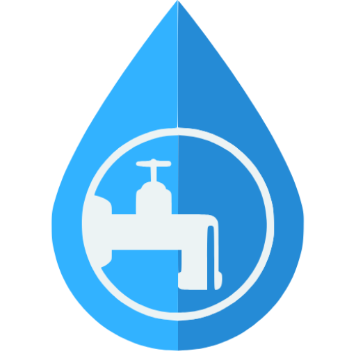

<div align="center">
  

  # AGUA-VP
  ### Sistema de Gestión de Agua Potable

  [](docs/releases_changelog.md)
  [](docs/releases_changelog.md)
  []()
  []()
  [-6366F1.svg)](docs/sincronizacion-turso-cloud.md)
</div>

---

## 📌 ¿Qué es AGUA-VP?

**AGUA-VP** es una aplicación de escritorio diseñada para la administración de comités y organismos locales de agua potable. Permite gestionar el ciclo operativo del servicio: padrón de clientes, control de medidores, captura de lecturas por rutas, cálculo de consumos, cobro de recibos y emisión de reportes.

La aplicación funciona de forma **local (offline)**; no requiere conexión a internet para su operación diaria y almacena sus datos en una base de datos SQLite integrada en el equipo. De manera **opcional**, puede mantener una **copia de respaldo en la nube (Turso Cloud)** que se actualiza sola en segundo plano.

---

## 🏛️ Estructura general de la aplicación

La aplicación está compuesta por tres partes principales:

- **Interfaz de usuario (Frontend):** Desarrollada con React, Vite y Tailwind CSS, ofreciendo una navegación ágil y modular con soporte de modo oscuro.
- **Proceso de escritorio (Electron):** Controla la ventana de la aplicación, el ciclo de vida del sistema, respaldos automáticos, la generación de PDF y la comunicación segura con el sistema operativo.
- **Base de datos y lógica local (Backend embebido):** Servidor local interno (`@aguavp/api-server`) con Express y base de datos SQLite (Better-SQLite3) con migraciones automáticas. Aquí viven las reglas del negocio: tarifas, facturación, pagos, convenios y cortes.

```
Interfaz (React) ──► Electron ──► Servidor local ──► SQLite (agua-vp.db)
                                        │
                                        └──► Copia en la nube (Turso, opcional)
```

---

## 📦 Módulos del sistema

Si requieres conocer a detalle el funcionamiento de cada apartado, consulta su documentación:

| Módulo | Descripción general | Documentación |
|---|---|:---:|
| **Clientes** | Registro de usuarios, asignación de predios, medidores y tarifas | [Ver guía](docs/modulo-clientes.md) |
| **Medidores** | Inventario de equipos físicos, ubicación y estado | [Ver guía](docs/modulo-medidores.md) |
| **Lecturas y Rutas** | Organización de recorridos, captura de consumo y rectificación de lecturas | [Ver guía](docs/modulo-lecturas.md) |
| **Tarifas** | Configuración de precios por rangos de consumo | [Ver guía](docs/modulo-tarifas.md) |
| **Pagos y Facturación** | Cobranza en ventanilla, abonos, convenios, cartera vencida y comprobantes | [Ver guía](docs/modulo-pagos.md) |
| **Impresión y Reportes** | Emisión de recibos, reportes de lecturas, financieros y general ejecutivo | [Ver guía](docs/modulo-impresion.md) |
| **Administración** | Usuarios, permisos, respaldos, logs y copia en la nube | [Ver guía](docs/modulo-administracion.md) |

Dentro de la aplicación, el apartado **Ayuda** contiene guías paso a paso de cada módulo (carpeta [`ayuda/`](ayuda/)).

---

## 🔄 Flujo de trabajo básico

```
1. Registrar clientes y vincularles su medidor y tarifa
        ↓
2. Organizar la ruta de recorrido
        ↓
3. Capturar las lecturas del período (el sistema calcula el consumo)
        ↓
4. Generar las facturas del mes
        ↓
5. Registrar los pagos en ventanilla
        ↓
6. Imprimir recibos y reportes
```

---

## 💾 Datos locales y copia en la nube

### Funcionamiento local (siempre)
- Toda la operación diaria (cobros, lecturas, impresión, reportes y consultas) se hace contra la base **local** `agua-vp.db`, guardada en `%APPDATA%\aguavp`. **Sin internet la app funciona igual.**
- **Respaldos locales:** copias completas y consistentes de la base, automáticas y manuales, que se conservan por fecha y por motivo (antes de restaurar y antes de actualizar). Se crean y restauran desde **Administrador ➔ Mantenimiento ➔ Backups**. Una restauración se aplica al reiniciar la app y se puede deshacer con el respaldo *Pre-restauración*.

### Copia en la nube (Turso Cloud, opcional)
- **Un solo sentido:** la computadora es la única que escribe; la nube solo recibe una copia y nunca modifica la base local.
- **Automática:** después de una carga completa inicial, cada 15 minutos se suben solo los registros que cambiaron. Si no hubo cambios no se usa la red; sin internet, los cambios esperan y se suben al reconectar.
- **Protegida:** nunca se vacía la nube antes de copiar. Si la base local parece perdida, antigua o de otra computadora, la sincronización se detiene y avisa en lugar de sobrescribir la copia.
- **Verificada:** después de cada subida se comparan los conteos, y una vez al día se compara el contenido completo tabla por tabla.
- **Restaurable:** *Restaurar desde la Nube* descarga la copia, la valida y la aplica al reiniciar, dejando antes un respaldo local.
- Se configura en **Administrador ➔ Mantenimiento ➔ Nube (Turso)**. Las credenciales se guardan cifradas en el equipo y solo un administrador puede operarla.

> 💡 **Para pasar la base a otra computadora** use *Crear respaldo ahora* en el equipo de origen y *Restaurar* en el destino (o *Restaurar desde la Nube*). No copie solo `agua-vp.db`: los cambios más recientes pueden estar todavía en `agua-vp.db-wal` y la copia quedaría incompleta.

Para saber más:
- [Sincronización en la nube con Turso](docs/sincronizacion-turso-cloud.md): arquitectura, seguridad, protección de la copia y recuperación ante desastres.
- [Plan y estado de la sincronización](docs/plan-sincronizacion-turso.md) y [prueba real de respaldo y restauración](docs/turso-caso-prueba-restauracion.md).
- [Módulo de Administración](docs/modulo-administracion.md): respaldos, logs y usuarios.

---

## 💻 Requisitos del sistema

- **Sistema operativo:** Windows 10 o Windows 11 (64 bits).
- **Memoria RAM:** 4 GB mínimo (8 GB recomendado).
- **Espacio en disco:** 500 MB libres.
- **Internet:** solo para la copia en la nube y las actualizaciones (opcional).
- **Para desarrollo:** Node.js 20.19+ (o 22.12+) y npm 9+.

---

## 🛠️ Comandos de desarrollo

```bash
# Instalar dependencias
npm install

# Iniciar en modo desarrollo
npm run dev

# Compilar instalador para Windows (.exe)
npm run build:win

# Pruebas automatizadas por módulo (Playwright)
npm run test:e2e

# Revisar formato y código
npm run lint
npm run format
```

Los instaladores generados se guardan en la carpeta `dist/`.

Las **pruebas automatizadas** (`tests/e2e/`) recorren la app real módulo por módulo (clientes, medidores, lecturas, tarifas, pagos, impresión y administración) sobre una **copia** de la base: nunca modifican los datos reales ni mandan nada a la impresora. Antes de correrlas, cierre AguaVP y `npm run dev`.

---

## 📁 Estructura del proyecto

```
AguaVP/
├── ayuda/               # Guías de Ayuda que se muestran dentro de la app
├── build/               # Recursos de empaquetado (iconos del instalador)
├── docs/                # Documentación detallada por módulo y de la nube
├── resources/           # Recursos estáticos de la aplicación
├── src/
│   ├── main/            # Proceso principal de Electron (Node.js)
│   │   ├── api-client/  # Cliente HTTP hacia el servidor local
│   │   ├── ipc/         # Canales de comunicación por módulo
│   │   ├── managers/    # Servidor embebido, respaldos, nube, logs y actualizaciones
│   │   └── pdf/         # Generación de recibos y reportes en PDF
│   ├── preload/         # Puente seguro entre el sistema y la interfaz
│   └── renderer/        # Interfaz de usuario (React + Vite)
│       └── src/
│           ├── vistas/      # Pantallas de cada módulo
│           ├── components/  # Componentes compartidos
│           ├── context/     # Estado global por dominio
│           └── hooks/       # Lógica reutilizable
├── tests/               # Pruebas automatizadas (Playwright)
├── package.json         # Dependencias y scripts
└── electron-builder.yml # Configuración de empaquetado para Windows
```

---

## 📄 Notas de versión

El historial de cambios y notas de cada lanzamiento se encuentra en el [Registro de Versiones (Changelog)](docs/releases_changelog.md).
