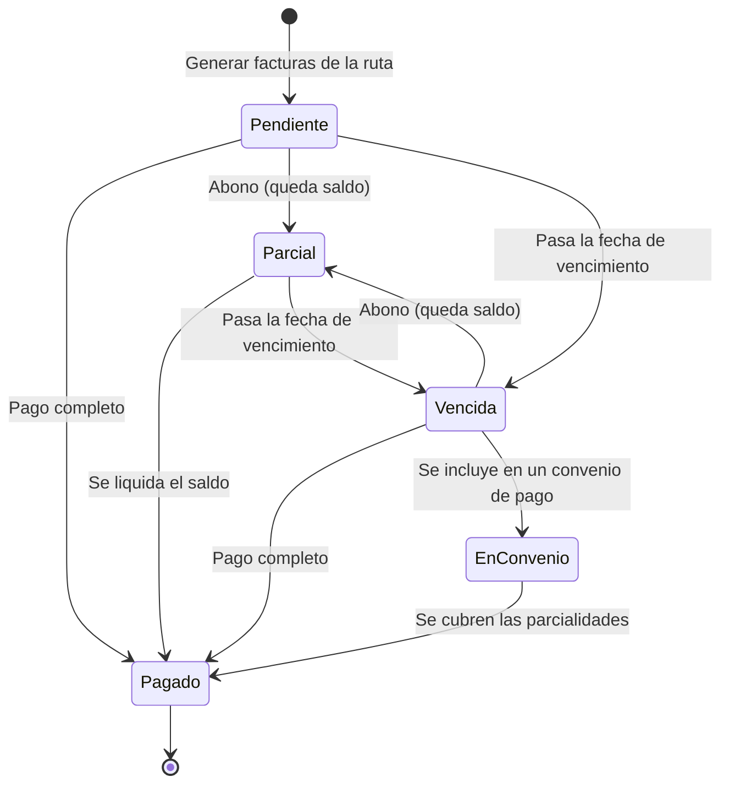

# 🔄 Ciclo de Vida y Estados de Facturas

Cada factura emitida en **AguaVP** transita por un ciclo de vida normado para garantizar la consistencia entre los consumos medidos en campo, el libro contable de ingresos y los arqueos diarios de caja.

---

## 🗺️ Diagrama de Transición de Estados

El cambio a **Vencida** lo hace el proceso diario del sistema. Los cambios por pagos (Parcial y Pagado) son inmediatos al registrar el cobro.

---

## 📌 Definición de los Estados

### 1. 🟡 Pendiente (vigente para cobro)
* **Condición**: la factura se generó desde la ruta de lecturas y su fecha de vencimiento todavía no pasa.
* **Características**:
  * El saldo pendiente es igual al total facturado.
  * Se puede cobrar con cualquier forma de pago (pago, pago rápido, pago distribuido).
  * Si no tiene pagos y su lectura no está cerrada, se puede **recalcular** (ver *Recálculo y Correcciones de Facturas*).

### 2. 🟠 Parcial (con abonos)
* **Condición**: se registró al menos un abono, pero todavía queda saldo.
* **Características**:
  * El saldo pendiente es el total menos lo abonado.
  * Al cubrir el resto pasa a **Pagado**.
  * Ya tiene pagos: **no se puede recalcular** y su lectura **no se puede rectificar**.

### 3. 🔴 Vencida (en mora)
* **Condición**: pasó la fecha de vencimiento y la factura todavía tiene saldo (estaba Pendiente o Parcial).
* **Características**:
  * Cuenta para los avisos y el **corte de servicio**: un medidor es candidato a corte al acumular el número de facturas vencidas configurado en *Configuración del servicio* (4 por defecto), una vez transcurridos los días de gracia y si no tiene un convenio activo.
  * Se puede seguir cobrando: un abono la deja en Parcial y un pago completo en Pagado.

### 4. 🔵 En Convenio
* **Condición**: la factura se incluyó en un **convenio de pago** (el adeudo se reparte en parcialidades).
* **Características**:
  * Se va cubriendo con los pagos de las parcialidades; al completarlas pasa a **Pagado**.
  * Su lectura no se puede rectificar ni la factura recalcular.

### 5. 🟢 Pagado (liquidada al 100%)
* **Condición**: los pagos registrados cubren todo el importe facturado (saldo pendiente $0).
* **Características**:
  * Queda vinculada a sus folios de pago y comprobantes de caja.
  * **Inmutabilidad contable**: no se puede recalcular ni rectificar su lectura, para proteger los cortes de caja.

---

## ⚡ Reglas de Negocio

> [!CAUTION]
> **Lo cobrado no se modifica**: una factura con pagos (**Parcial** o **Pagado**) o **En Convenio** no se recalcula y su lectura no se puede rectificar. Lo mismo aplica cuando el medidor ya tiene la lectura del mes siguiente: ese mes quedó cerrado.  
> Si existió un cobro indebido, el ajuste se aplica en el mes en curso (por ejemplo, un descuento o un cargo en la siguiente factura), de modo que lo cobrado y los reportes anteriores sigan coincidiendo.

> [!NOTE]
> **Al recalcular**, una factura sin pagos vuelve a **Pendiente** con el nuevo importe. Si su fecha de vencimiento ya pasó, el proceso diario la marca otra vez como **Vencida**.

> [!TIP]
> En **Pagos → Facturas** puede filtrar por cualquiera de los cinco estados, y por antigüedad del vencimiento (más de 30, 60 o 90 días).
