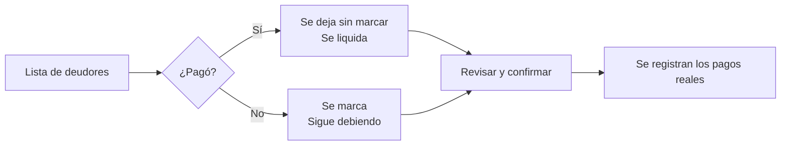

# ⚡ Liquidación Total y Corte de Período

En los días de corte, la mayoría de los usuarios paga su recibo completo. Para no capturar cientos de pagos uno por uno, **Pagos > Cobranza por Cliente** tiene dos herramientas de liquidación masiva:

| Herramienta | Qué liquida | Qué se marca |
|---|---|---|
| **Liquidación Total** | La deuda completa de cada cliente (todos sus meses pendientes). | Los **clientes** que siguen debiendo. |
| **Liquidación de Periodo** | Solo las facturas de **un periodo** elegido. | Las **facturas** que no se pagaron. |

---

## 🚀 El principio: se marca a quien NO pagó

> **En lugar de registrar a todos los que pagaron, el cajero solo marca a los que "SIGUEN DEBIENDO".**
> Al resto se le registra el pago completo automáticamente.

> [!TIP]
> Tu selección **se guarda automáticamente**: si cierras la ventana o la aplicación a medio trabajo, al volver siguen marcados los mismos clientes. Solo se borra cuando la liquidación termina con éxito.

---

## 📋 Liquidación Total por Cliente

1. En **Cobranza por Cliente**, presione **Liquidación Total**.
2. La ventana se divide en dos columnas:

**Columna izquierda — resumen y datos del pago**
* Indicadores: **Total Deudores**, **Siguen Debiendo**, **Se Liquidan** y **Total a Aplicar**.
* **Método de pago**, **Fecha de pago** y **Comentario** (nota interna).
* Casilla **Excluir mes nuevo** (ver más abajo).

**Columna derecha — lista de clientes**
* Buscador por cliente o predio, y orden **por número de predio**, **mayor deuda** o **menor deuda**.
* **Ver solo marcados**, **Marcar todos** y **Resetear** para trabajar más rápido.
* Cada fila muestra predio, facturas pendientes y el monto que se liquidará. Marque la casilla para cambiarla de **Liquidar** a **Sigue debiendo**.

3. Presione **Revisar y confirmar (N)**.
4. Revise el resumen. Con **Volver** regresa a la lista sin perder lo marcado.
5. Presione **Liquidar N cliente(s) · \$importe** y acepte el aviso final. Se registran los pagos y las cuentas quedan al corriente.

### Saldos que se protegen solos
* **Convenios**: las facturas en convenio **no** se liquidan con esta herramienta; aparecen como “+ \$… convenio” debajo del monto.
* **Mes nuevo**: si el periodo más reciente todavía **no está vencido**, la casilla **Excluir mes nuevo** se activa sola (✨ *Autodetectado*) para no cobrarlo por adelantado. Si quiere quitarla, el sistema pide confirmación.

---

## 🗓️ Liquidación de Periodo

Funciona igual, pero sobre las facturas de un solo mes.

1. En **Cobranza por Cliente**, presione **Liquidación de Periodo** y elija el periodo.
2. Indicadores: **Total Elegibles**, **Excluidas (No pagaron)**, **Se Cobrarán** y **Total a Cobrar**.
3. En la lista, marque las facturas que **no** se pagaron (pasan de **Cobrar** a **Excluida**).
4. Presione **Revisar y confirmar (N)** y después **Aplicar pago a N factura(s) · \$importe**.

> [!CAUTION]
> Ambas herramientas **registran pagos reales**. Revise bien el resumen antes de confirmar: un cliente que se quedó sin marcar por error queda como pagado.

---

## 🛡️ El Seguro de Detección de Cobranza Previa (`validarCobranzaPeriodo`)

Este es uno de los **mecanismos de seguridad más importantes** de todo el sistema AguaVP:

### ¿Por qué es fundamental realizar el corte antes de las nuevas lecturas?
1. Si un operador intenta capturar lecturas o generar facturas del nuevo mes sin haber liquidado los pagos del mes anterior, el sistema detecta que existe un alto porcentaje de facturas impagas.
2. El motor de validación dispara la **Alerta de Precaución de Cobranza**:
   > *"¡Se detectó un alto índice de facturas sin pagar del período anterior! Han quedado pendientes X de Y facturas (Z%). Si generas los recibos ahora, los usuarios acumularán el mes sin que se haya procesado su pago previo."*
3. **Consecuencia de omitir este paso**: Al generar la nueva facturación, el sistema sumaría los adeudos del mes anterior no liquidados en el nuevo recibo, provocando quejas ciudadanas por cobros dobles en ventanilla.

---

## ⚡ Regla de Oro Operativa

> [!CAUTION]
> **Secuencia Obligatoria**:  
> **1.** Cerrar caja y ejecutar **Liquidación Total** (o **de Periodo**) del mes anterior.  
> **2.** Iniciar captura de **Lecturas** del nuevo período.  
> **3.** **Generar Facturas** del nuevo mes.
