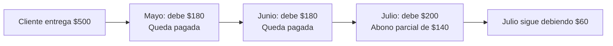

# 🔄 Registro de Pagos y Abonos Distribuidos

Cuando un cliente tiene varios meses pendientes o quiere dejar un abono a su cuenta, se usa el **Cobro Distribuido**. El cajero solo captura **cuánto dinero entregó el cliente**; el sistema decide a qué facturas se aplica y cuánto cambio hay que devolver.

---

## 🧠 Cómo se reparte el pago

El dinero siempre se aplica **primero a la factura más antigua**. Cuando esa queda saldada, lo que sobra pasa a la siguiente, y así hasta terminar el dinero. Lo que sobre al final es el **cambio**.

1. Se consideran solo las facturas **con saldo pendiente** que no estén pagadas.
2. Se ordenan de la **más antigua a la más reciente**.
3. Cada factura recibe lo necesario para quedar en cero; si el dinero no alcanza, recibe un **abono parcial**.
4. Si el dinero entregado es mayor que toda la deuda, la diferencia se muestra como **Cambio a devolver**.

> [!NOTE]
> El orden es automático y no se puede cambiar: así se evita que las deudas viejas se queden atrás mientras se pagan los meses recientes.

---

## 📋 Pasos para registrar el cobro

1. En **Pagos > Cobranza por Cliente**, presione **Cobrar** en la fila del cliente.
2. Se abre la ventana de cobro con dos columnas:

### Columna izquierda: lo que entrega el cliente

* **Deuda total** del cliente, como referencia.
* **Cantidad Entregada**: empieza **vacía** a propósito. Escriba el dinero que el cliente entregó realmente.
  * Botones rápidos **$50, $100, $200, $500** para montos comunes.
  * Botón **Total**: llena la cantidad con la deuda completa del cliente.
* **Método de pago**: Efectivo, Transferencia, Tarjeta o Cheque.
* **Fecha de pago** (no puede ser una fecha inválida).
* **Comentario** opcional (nota interna del pago).

### Columna derecha: cómo se reparte el pago

* Resumen de **Recibido → Se aplica a N facturas → Cambio a devolver**.
* Tabla **Cómo se reparte el pago**, que se actualiza mientras escribe:

| Columna | Qué indica |
|---|---|
| **Orden** | En qué turno recibe dinero la factura (1 = la más antigua). |
| **Factura / Periodo** | Folio y mes facturado. |
| **Debe** | Saldo pendiente antes del cobro. |
| **Se aplica** | Dinero que recibirá esa factura (— si no le alcanza). |
| **Queda debiendo** | Saldo que quedará después del cobro. |
| **Resultado** | *Queda pagada*, *Abono parcial* o *Sin abono*. |

* Al pie: cuántas facturas quedan pagadas y la **Deuda después del cobro**.

3. Presione **Revisar y Cobrar**.
4. En la pantalla **Confirmar Cobro** verifique el total recibido, lo que se aplica, el cambio, las facturas que reciben dinero y la deuda que queda.
5. Presione **Confirmar Pago**. Al terminar verá **Cobro Exitoso** con el número de facturas afectadas y el monto aplicado; cierre con **Finalizar y Cerrar**.

> [!TIP]
> Si algo falla al guardar, aparece **Error en la transacción** con la opción **Reintentar** (vuelve a la confirmación sin perder los datos) o **Cancelar Cobro**.

> [!IMPORTANT]
> Esta ventana registra el pago, pero **no imprime un comprobante** por sí sola. Para entregar un ticket, consúltelo después desde **Historial de Pagos y Comprobantes**.
