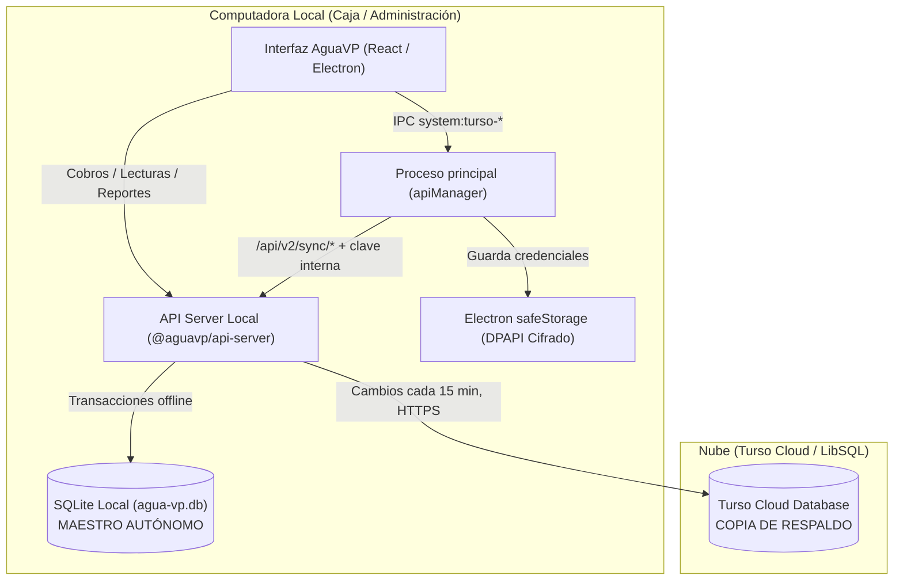

# Sincronización en la Nube con Turso Cloud

Este documento describe la arquitectura, configuración, medidas de seguridad y procedimientos operativos del sistema de sincronización y respaldo en la nube integrado en **AguaVP**.

> Versión documentada: app con `@aguavp/api-server` **1.0.11**. Especificación técnica del servicio: `api-AguaVP/docs/SINCRONIZACION_TURSO_CLOUD.md`. Plan de mejoras y estado: [plan-sincronizacion-turso.md](plan-sincronizacion-turso.md). Prueba real y pendientes: [turso-caso-prueba-restauracion.md](turso-caso-prueba-restauracion.md).

---

## 1. Visión General y Arquitectura

AguaVP opera bajo un modelo **Local-First con Réplica en la Nube** (copia de seguridad de un solo sentido):



### Principios Fundamentales
1. **Autonomía Local Total:** cobros, impresión, lecturas y consultas se ejecutan contra el SQLite local (`agua-vp.db`). Sin internet, la app funciona igual.
2. **Un Solo Escritor:** todas las escrituras nacen en la base local y se copian a Turso. La nube nunca escribe en la base local.
3. **La copia de la nube no se pone en riesgo:** ninguna operación de sincronización vacía la nube antes de copiar, y la carga completa se **bloquea** si la base local parece perdida, vacía o antigua (sección 5).

---

## 2. Seguridad y Protección de Credenciales

* **Cero credenciales en código o `.env`:** la URL y el token de Turso se capturan en la interfaz.
* **Cifrado con Electron `safeStorage`:** en Windows se cifran con **DPAPI** antes de guardarse en `api-secrets.enc` (carpeta de datos del usuario).
* **Control de acceso real:** guardar o eliminar credenciales, sincronizar y restaurar respaldos locales exigen una sesión **válida y vigente** de `administrador` o `superadmin`. El token se verifica con el secreto JWT real de la API embebida (`verifySessionToken` en `apiManager`). Sin sesión, con sesión expirada o con rol `operador`, la acción se rechaza.
* **Endpoints protegidos:** `/api/v2/sync/*` solo acepta peticiones con la clave interna de la app (header `x-aguavp-internal-key`) o con el JWT de un administrador. Nadie en la red local puede reconfigurar ni disparar la sincronización.
* **Ocultación del token** en pantalla y limpieza del campo tras guardarlo.

---

## 3. Configuración en la Interfaz (Paso a Paso)

1. Ingresar a AguaVP con una cuenta de **Administrador**.
2. Ir a **Administrador** ➔ **Mantenimiento** ➔ pestaña **"Nube (Turso)"**.
3. Completar:
   * **URL de la Base de Datos Remota:** `libsql://nombre-base-usuario.turso.io`.
   * **Token de Autenticación:** generado en la consola web o con la CLI de Turso.
   * **Auto-Sincronización:** sincronización en segundo plano cada 15 minutos.
4. **"Probar Conexión"**: verifica conectividad y latencia sin guardar.
5. **"Guardar y Vincular"**: cifra y guarda las credenciales.
6. **"Sincronizar Ahora"** o esperar el ciclo automático: la primera vez con una base de Turso se ejecuta la **carga completa** (todas las tablas). "Subir Base Completa a Turso" fuerza esa carga completa en cualquier momento.

> Vincular **otra** URL de Turso provoca automáticamente una carga completa hacia la nueva base.

---

## 4. Consumo Eficiente y Cuota de 3 GB / Mes

* **Registro local de cambios:** cada alta, edición o borrado se anota en la tabla local `sync_cambios`. Antes de cualquier petición de red se revisa ese registro.
* **Cero red en reposo:** si no hubo cambios desde la última sincronización, no se hace ninguna llamada a Turso. Las tablas de sesiones y tokens no se registran (cambian en cada renovación de sesión).
* **Ciclo cada 15 minutos**, más una **verificación completa** de la copia una vez al día (pocas consultas de conteo).
* **Estado persistente:** la última sincronización y el punto de avance del registro se guardan en la base local (`sync_estado`). La carga completa **no se repite en cada arranque**; solo se ejecuta la primera vez, al vincular otra base, cuando la nube no corresponde a esta base, o cuando la app activa el registro de cambios por primera vez (al actualizar a 1.0.8) o en una tabla nueva.

Estimación: carga completa de una base típica = unos cientos de KB a pocos MB; operación mensual = pocos MB (solo se suben los registros modificados).

---

## 5. Protección de la Copia en la Nube

### Identidad de la base
Cada base local tiene un identificador (`instancia_id`) guardado en `sync_estado`. Las tablas `sync_estado` y `sync_cambios` son solo locales: nunca se suben. La nube guarda el mismo identificador, la fecha de la última sincronización, la versión del esquema y los conteos de registros en la tabla `_aguavp_sync_meta`.

### Carga completa protegida
Antes de copiar, se compara la base local con la nube. La carga se **bloquea** si:
* la nube pertenece a **otra base** (otra instalación, o una base nueva creada tras perder la original), o
* la nube tiene **más registros** que la local en alguna tabla de negocio: clientes, medidores, lecturas, facturas, pagos, tarifas o usuarios.

En ese caso la sincronización se detiene, **la nube conserva sus datos** y el panel muestra el aviso *"La sincronización está detenida para proteger la copia en la nube"* con la comparación de registros.

### Qué hacer ante el aviso
* **Si la base local se perdió, se dañó o se restauró un respaldo antiguo:** NO reemplazar la nube. Recuperar los datos desde la nube (sección 8).
* **Si los datos de la nube ya no sirven** (por ejemplo se borraron registros a propósito, o se quiere apuntar a esta base): botón **"Revisar"** ➔ dos confirmaciones ➔ la nube se reemplaza con la base local.

### Sin vaciar la nube
La carga completa inserta/actualiza todas las filas y **al final** borra en la nube solo los registros que ya no existen en local. Si se corta internet a mitad, la nube queda con sus datos anteriores más una parte de los nuevos; la siguiente sincronización la completa.

### Actualizaciones de la app
Si una nueva versión agrega columnas o tablas a la base local, se crean automáticamente en la nube antes de copiar.

---

## 6. Ciclo de Vida de Datos

Mientras la nube está vinculada, la base local tiene triggers de registro (`_sync_<tabla>_ins/upd/del`) en **todas** las tablas que se sincronizan. Cada alta, edición o borrado —hecho por la app, por un trigger de negocio (p. ej. el saldo que se descuenta al registrar un pago) o por un borrado en cascada— queda anotado en `sync_cambios`.

En cada ciclo se sube el **estado actual** de los registros anotados:
* si el registro existe en local, se inserta o se **actualiza en su lugar** en la nube (sin borrarlo: así Turso no aplica borrados en cascada a tablas relacionadas);
* si ya no existe (se borró), se borra en la nube.

Luego se marcan como subidos y se eliminan del registro. Si internet falla a mitad, el registro conserva los cambios y se reintentan en el siguiente ciclo.

* **Bajas lógicas** (`estado = 'Eliminado'`) se suben como ediciones.
* **Carga completa:** además de copiar todo, elimina en la nube los registros que ya no existen en local.
* Al **desvincular** la nube se quitan los triggers de registro; al volver a vincular se hace una carga completa.

### Verificación de la copia
Después de subir cambios se comparan, en una sola consulta, la cantidad de registros y el id más alto de las tablas tocadas (una vez al día, de todas las tablas). Si una tabla no coincide, se vuelve a subir completa y se borran en la nube los registros sobrantes, **excepto** en clientes, medidores, lecturas, facturas, pagos, tarifas y usuarios: ahí los registros que solo existan en la nube se **conservan** y el panel lo indica ("⚠️ Diferencias en: …").

### Qué no se sube
`sesiones`, `refresh_tokens`, `tokens_revocados` y `password_recovery_tokens` (credenciales de sesión de vida corta). Las copias anteriores a 1.0.8 que las contenían se vacían en la siguiente carga completa. Tras restaurar desde la nube, los usuarios solo vuelven a iniciar sesión.

---

## 7. Triggers (Disparadores) y Restauración

### ¿Por qué no hay triggers en la nube?
Los triggers de negocio (`validar_pago_contra_saldo`, `actualizar_saldo_factura`, etc.) recalculan saldos o rechazan pagos. Al copiar pagos históricos de facturas ya saldadas, esos triggers los rechazarían o volverían a descontar los saldos. Por eso **Turso almacena los datos ya calculados por la base local, sin triggers**.

### ¿Qué pasa al usar una base descargada de Turso?
Al iniciar, el migrador de la API (`ensureCoreTriggers`) recrea los **9 triggers** de negocio con su definición vigente:

| Trigger | Función |
|---|---|
| `validar_pago_contra_saldo` | Un pago no puede exceder el saldo de la factura |
| `validar_pago_parcialidad` | El pago de una parcialidad debe ser exactamente el monto esperado |
| `validar_tipo_pago` | Un pago va a una factura o a una parcialidad, no a ambas |
| `actualizar_saldo_factura` | Descuenta el pago del saldo de la factura |
| `actualizar_estado_factura` | Saldo 0 → factura "Pagado" |
| `actualizar_estado_factura_parcial` | Pago incompleto → factura "Parcial" |
| `registrar_cambios_facturas` | Auditoría de cambios en facturas |
| `cerrar_historial_asignacion_anterior` | Cierra el historial al retirar/reasignar un medidor |
| `registrar_historial_asignacion` | Registra la asignación de un medidor a un cliente |

Una prueba automática (`api-AguaVP/src/test/unit/core-triggers.test.js`) garantiza que estas definiciones sean iguales a las de las migraciones.

---

## 8. Recuperación ante Desastres

> **Antes de recuperar, NO usar "Revisar → reemplazar la nube"**: la copia en la nube es la que contiene tus datos.

### Restaurar desde la app (recomendado)

1. **Si la computadora es nueva o se reinstaló AguaVP:** instalar la versión actual e iniciar sesión. Con una base nueva existe el usuario administrador inicial.
2. Ir a **Administrador → Mantenimiento → Nube (Turso)**. Si las credenciales no están, capturar la URL y el token y pulsar **"Guardar y Vincular"** (no se sube nada: la base vacía nunca reemplaza la nube).
3. Pulsar **"Restaurar desde la Nube"**. Se muestra la fecha de la copia y la comparación de registros nube / esta computadora. Confirmar dos veces.
4. La app (sin tocar todavía la base en uso):
   * crea una base **nueva con el esquema de la versión instalada** y sus 9 triggers de negocio;
   * copia los datos de la nube (las columnas que la nube no tenga toman su valor por defecto; las tablas y columnas que estén en la nube pero no en esta versión se **conservan**);
   * la **valida**: integridad, misma cantidad de registros que la nube por tabla y triggers completos. Si algo falla, se cancela y la base actual queda igual.
5. AguaVP se **reinicia**. Antes de abrir la base:
   * guarda un **respaldo de la base actual** en `backups/` (incluye los cambios recientes);
   * reemplaza la base por la restaurada.
6. Iniciar sesión de nuevo (las sesiones no se respaldan). La base restaurada **hereda la identidad** de la copia: la primera sincronización hace una carga completa protegida y verificada, sin conflicto.

> En desarrollo (`npm run dev`) la app se cierra en lugar de reiniciarse; vuelve a ejecutar `npm run dev` y la restauración se aplica al arrancar.

### Restauración manual (si la app no arranca)

1. Obtener la copia con la CLI de Turso y sqlite3:
   ```bash
   turso db shell mi-base-aguavp .dump > respaldo_recuperado.sql
   sqlite3 agua-vp.db < respaldo_recuperado.sql
   ```
2. Con la app **cerrada**, copiar `agua-vp.db` a la carpeta de datos de la app (`%APPDATA%`, ruta exacta en **Mantenimiento → Base de datos**) y **borrar** `agua-vp.db-wal` y `agua-vp.db-shm` si existen.
3. Iniciar AguaVP: se aplican migraciones pendientes y se recrean los triggers. Volver a vincular Turso.

> Límite de la vía manual: el volcado trae el esquema de la nube; si la copia se hizo antes de una actualización que agregó columnas, esas columnas pueden quedar sin valor por defecto. La restauración desde la app no tiene este problema.

### Respaldos locales

Además de la nube, la app guarda respaldos en `backups/` (al arrancar, antes de actualizar y antes de restaurar; 5 por defecto). Desde esta versión (API 1.0.9) se generan con `VACUUM INTO`, que incluye los cambios recientes que aún estaban en el archivo `-wal`; antes eran una copia del archivo principal y podían omitirlos. Restaurar un respaldo local también se aplica **al reiniciar** la app: copiar un archivo encima de la base abierta podía deshacer la restauración. Después de restaurar un respaldo local, la siguiente sincronización hace una **carga completa protegida**: si la nube tiene más datos que el respaldo, pide confirmación; si no, vuelve a subir todo y corrige la copia.

---

## 9. Diagnóstico

* **Panel "Nube (Turso)":** fecha de la última copia, estado (verificado / diferencias en tablas / aviso de red / conflicto pendiente) y cambios por subir.
* **Integridad:** la carga completa ejecuta `PRAGMA quick_check` sobre la base local; si falla, **no se sube** (ni siquiera con reemplazo forzado) y el error aparece en el panel. En ese caso, restaurar un respaldo local o la copia de la nube.
* **Consola del proceso principal** (terminal de `npm run dev`): mensajes `[TursoSync]` con el inicio y resultado de cada carga y el motivo de cada bloqueo. Todavía no llegan al visor de Mantenimiento → Logs (Paso 4 del plan).
* **Errores de red** no detienen la app: se reintenta en el siguiente ciclo.
