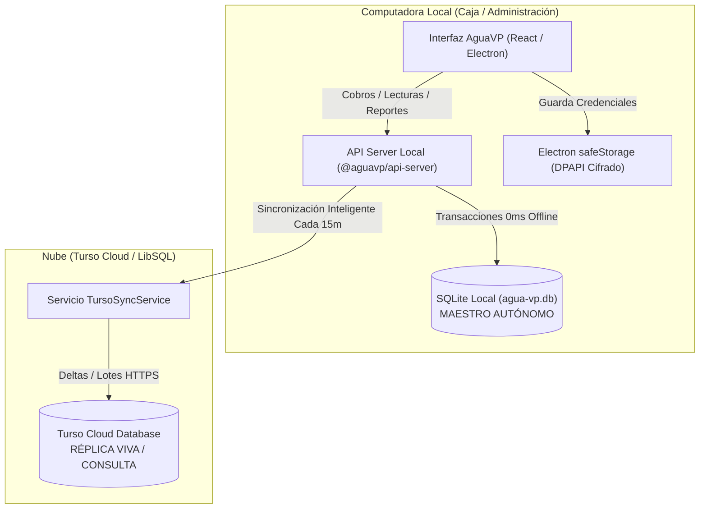

# Sincronización en la Nube con Turso Cloud

Este documento describe la arquitectura, configuración, medidas de seguridad y procedimientos operativos del sistema de sincronización y respaldo en la nube integrado en **AguaVP**.

---

## 1. Visión General y Arquitectura

AguaVP opera bajo un modelo **Local-First con Réplica Viva en la Nube**:



### Principios Fundamentales:
1. **Autonomía Local Total:** El 100% de los cobros, impresión de recibos, tomas de lecturas y consultas operativas se ejecutan contra la base de datos SQLite local (`agua-vp.db`). Si no hay internet o el enlace es lento, el sistema no se congela ni interrumpe su operación.
2. **Réplica Viva Remota:** La base de datos en Turso Cloud es una copia de respaldo accesible vía internet para los administradores, auditorías o dashboards externos.
3. **Un Solo Escritor Maestro:** Todas las escrituras de negocio nacen en el SQLite local y se replican hacia Turso. Esto elimina conflictos de concurrencia y sobreescrituras accidentales.

---

## 2. Seguridad y Protección de Credenciales

Para mantener el software seguro y apto para distribución abierta:
* **Cero Credenciales en Código o `.env`:** La URL de la base de Turso y el Token JWT **nunca** se queman en el repositorio ni en archivos de texto plano.
* **Cifrado con Electron `safeStorage`:** En Windows, las credenciales se cifran mediante la API criptográfica nativa del sistema operativo (**DPAPI** de Windows) antes de guardarse en disco (`api-secrets.enc`).
* **Control de Acceso (RBAC):** Únicamente usuarios con rol de `superadmin` o `administrador` tienen permiso para ver la configuración, vincular credenciales o disparar sincronizaciones manuales.
* **Ocultación Visual del Token:** La interfaz oculta el token por defecto con selector para mostrar/ocultar y limpia el campo en pantalla tras ser guardado.

---

## 3. Configuración en la Interfaz (Paso a Paso)

1. Ingresar a AguaVP con una cuenta de **Administrador**.
2. Navegar al menú lateral: **Administrador** ➔ **Consola del Sistema**.
3. Seleccionar la pestaña **"Nube (Turso)"**.
4. Completar los campos:
   * **URL de la Base de Datos Remota:** Formato `libsql://nombre-base-usuario.turso.io`.
   * **Token de Autenticación (Auth Token):** Token JWT generado desde la consola web de Turso o Turso CLI.
   * **Auto-Sincronización:** Casilla activada para permitir el respaldo en segundo plano.
5. Hacer clic en **"Probar Conexión"**: Verifica la latencia y la conectividad sin guardar.
6. Hacer clic en **"Guardar y Vincular"**: Cifra y guarda las credenciales en el almacén seguro.
7. Para la primera vinculación, hacer clic en **"Subir Base Completa a Turso"**: Realiza la carga semilla de todas las tablas y registros históricos.

---

## 4. Consumo Eficiente y Cuota de 3 GB / Mes (Zero-Waste)

El plan gratuito de Turso incluye una cuota mensual de transferencia de **3 GB**. Para garantizar que el uso se mantenga en menos del 1% de dicha cuota:

* **Inspección Delta Local Previa:** Antes de realizar cualquier petición HTTP a Turso, el sincronizador incremental analiza el SQLite local (`historial_cambios`, `fecha_creacion` y `fecha_modificacion`).
* **Consumo Cero en Reposo:** Si no se han registrado cobros, altas ni lecturas nuevas desde la última sincronización, **no se realiza ninguna llamada de red (0 bytes consumidos)**.
* **Frecuencia Balanceada:** El ciclo en segundo plano corre cada **15 minutos** (en lugar de cada 1 o 5 minutos).
* **Catálogos bajo demanda:** Tablas casi estáticas como tarifas o configuración del servicio solo se sincronizan si sufrieron modificaciones registradas.

### Estimación de Consumo Real:
* **Carga Semilla Inicial:** ~390 KB (una sola vez).
* **Operación Mensual Estándar:** ~2 a 10 MB al mes.
* **Margen de Seguridad:** Más del **99.7%** de la cuota mensual de 3 GB queda libre.

---

## 5. Ciclo de Vida de Datos (Altas, Bajas y Modificaciones)

El sincronizador soporta el ciclo de vida completo de las operaciones de negocio:

* **Altas (`INSERT`):** Se identifican por `datetime(fecha_creacion) >= datetime(lastSync)` y se replican en orden de dependencias foráneas.
* **Modificaciones (`UPDATE`):** Se identifican a través de `historial_cambios` y actualizan la réplica en Turso mediante `INSERT OR REPLACE`.
* **Bajas Lógicas (Papelera / `SOFT_DELETE`):** Se actualizan con `estado_cliente = 'Eliminado'`, preservando el historial en ambas bases.
* **Bajas Físicas (Purgado / `HARD_DELETE`):** Se detectan en `historial_cambios` y ejecutan inmediatamente un `DELETE FROM [tabla] WHERE id = ?` en Turso Cloud, garantizando que los registros eliminados definitivamente no persistan en la nube.
* **Blindaje contra Condiciones de Carrera:** El marcador `lastSync` se captura al inicio del ciclo de sincronización (`syncStartTime`), evitando que transacciones realizadas durante la subida queden fuera del siguiente ciclo.
* **Normalización de Fechas:** Las consultas utilizan la función canónica `datetime(?)` de SQLite para neutralizar diferencias de representación (`YYYY-MM-DD HH:MM:SS` vs ISO-8601 con `T`).

---

## 6. Arquitectura de Disparadores (Triggers) y Restauración

### ¿Por qué se desactivan los triggers en la réplica de Turso?
En SQLite, los triggers de negocio (`validar_pago_contra_saldo`, `actualizar_saldo_factura`, etc.) validan que un pago no supere el saldo pendiente. Al copiar facturas históricas que ya fueron saldadas (`saldo_pendiente = 0.00`), intentar insertar sus pagos originales haría que los triggers abortaran la inserción con un error de restricción (`SQLITE_CONSTRAINT`).

Por tal motivo, **Turso almacena los datos en bruto ya calculados por el maestro local**, sin disparadores que re-calculen o bloqueen transacciones históricas.

### ¿Qué pasa si descargo la base de datos de Turso a una computadora nueva?
Si el equipo local sufre un daño o se migra de computadora:
1. Se descarga la base de datos desde Turso y se ubica como `agua-vp.db` en el nuevo equipo.
2. Al iniciar AguaVP, el módulo de arranque (`sqlite-migrator.js`) detecta automáticamente la ausencia de los disparadores esenciales.
3. El sistema ejecuta `ensureCoreTriggers()`, **recreando todos los triggers de cobro, validación de saldos y auditoría en menos de 5 milisegundos**.
4. La aplicación queda 100% operativa y autónoma de inmediato.

---

## 7. Procedimiento de Recuperación ante Desastres (Disaster Recovery)

Si la computadora principal queda inoperativa:

1. **Obtener el respaldo de la nube:**
   * Desde la consola de Turso CLI:
     ```bash
     turso db shell mi-base-aguavp .dump > respaldo_recuperado.sql
     sqlite3 agua-vp.db < respaldo_recuperado.sql
     ```
   * O bien utilizando la herramienta de exportación de base de datos de Turso.
2. **Instalar AguaVP en la nueva máquina:** Instalar el ejecutable de la versión actual.
3. **Copiar la base de datos:**
   * Pegar el archivo restaurado en la ruta de datos del usuario:
     * Windows: `%APPDATA%\AguaVP\database\agua-vp.db` (o ruta configurada en `DB_PATH`).
4. **Iniciar AguaVP:**
   * La aplicación aplicará las verificaciones automáticas de esquema e índices.
   * Todos los clientes, lecturas, facturas, cobros y usuarios estarán disponibles.
   * En el panel de administrador, re-ingresar las credenciales de Turso para reactivar la sincronización continua.
